# 范式地图

[`NAMING.md`](./NAMING.md) 的派生视图。**两者冲突时以 NAMING.md 为准**——契约是
正文，这张图只是索引加推导链，它会随正文演进而过时。

排列顺序不是章节顺序，是**推导顺序**：先有证据基座，才谈得上规则；规则 1 与
规则 6 是唯一一对互为承重的梁，其余四条规则独立成立；形状定了才问住哪里，住哪里
定了才问能绑到哪；最后才是从今天的文件走到目标要付多少钱，以及仍然悬着的六项。

Mermaid 的 `mindmap` 只能画纯层级，画不出横向关系。下面几处关系在图里被压成了
兄弟节点，读的时候要补回来：

- 规则 1 与规则 6 **互为前提**——一个定词的写法，一个定连字符的唯一含义，少了
  任一条另一条就不成立。
- 集合数不是审美选择，是**算式**——事实二定下限，事实一定上限，事实三定搞错的
  代价，三者夹出 8 这个数字。
- 八项删除与四项合并**卡在同一个证据缺口**上——dump 不读图层绑定。所以补一次
  Figma 使用视图的查核，能同时解锁这两项。

```mermaid
mindmap
  root((Aviala 变量命名范式))
    零 · 证据基座
      一次真实 dump 测得
        本地 167 个变量 · 5 个集合 · 8 个模式
        外部 42 个 · 来自 Aviala Design Colors 库
        合计 209
      值的构成
        156 个别名 · 143 个具体值
        最大链深 2 · 无环 · 无未解析目标
      三个全为零的字段
        codeSyntax 全空 · 所以一个名字处处通用
        hiddenFromPublishing 本地全为 false
        description 一个都没有 · 单位与极性无处可查
      两条限制
        dump 是单文件引用切片 · 不是普查
        跨集合别名塌缩到目标的默认模式 · 没有 Dark hex 实证
      书写约定
        表格默认写目标名 · 不是今天的名字
    一 · 承重梁
      规则 1 定词的写法
        字符集 a-z A-Z 数字与连字符
        段首小写 · 段内复合词 camelCase
      规则 6 定连字符的唯一含义
        连字符只分隔槽位
        camelCase 只分隔词
      反证一 · 全 kebab 会怎样
        no-background 与 background 同形
        只能靠封闭词表反查才能分开
      反证二 · 全 camelCase 会怎样
        semantic 66 个叶子里 66 个含两个以上段边界
        component 29 个里 29 个
        全驼峰后同名冲突 0 组 · 所以并非不可行
        代价是分段能力归零 · 校验降级成整名查字典
      推论一 · 合并还是分开由槽位表决定
        primaryBackground 在 semantic 的 box 里是一个槽位
        primary-background 在 component 里是两个槽位
        机械转换会误伤 component 6 个
      推论二 · 词表优先于任何字符串变换
        background-blackOnly 的目标是 background-black-only
        因为 black 是 polarity · only 是 step
    二 · 其余四条全局规则
      规则 2 分组必填 · 分组第一段就是命名空间
      规则 3 叶子不得重复分组
        209 个里 163 个今天在重复
        判定基准是整个分组名 · 不是它的第一截
      规则 4 用单数 · button 不写 buttons
      规则 5 每个槽位从封闭词表取词
        一个词在此槽位合法 · 不等于在彼槽位也合法
    三 · 名字的形状 · 五个命名空间
      palette
        形状 family/step · 字面值
        family 封闭 6 词 · step 彩色 1 到 12 · neutral 1 到 14
        42 个全部远端只读 · 必须回源库改
        它是别名图的根 · 134 个单元格指向它
      semantic
        形状 use/tone-slot · palette 别名
        use 封闭 4 词 · tone 封闭 6 词
        66 个 · 枢纽层 · 上送 132 下收 17
        normal 分级 · 其余五个色调单一强度
        tone 决定 palette 家族 · 无例外
        fail 改 error · infomation 改 info · 各 9 个
      scale
        形状 category/step · 字面值
        category 封闭 8 词
        62 个 · 按 mode 轴摊到三个集合
      component
        形状 type-component-level-role-state
        type 封闭 7 词 · role 封闭 2 词 · state 封闭 7 词
        29 个 · 17 个别名加 12 个表达式
        25 个叶子逐字不变
      effect
        形状 effect/name-position · 字面值
        name 封闭 2 词 · position 封闭 4 词
        10 个 · 值层 5 加开关层 5
        两层不是重复 · 是引用加开关
        绑 effectSwitch · 永远不绑 effect
    四 · 名字住哪里 · 集合与模式
      三条 Figma 事实
        模式属于集合 · 加一个模式等于每个变量多一个单元格
        图层对每个集合只绑一个模式 · 所以一个集合一条轴
        没有移动操作 · 只能重建再删除
      集合数是算出来的 · 不是审美
        事实二定下限 · 每条轴一个
        事实一定上限 · 不要多
        事实三定搞错的代价
        结果 8 个集合承载 4 条轴
      目标布局
        semantic 66 · theme 轴 Light 与 Dark
        effect 5 · 无轴
        effectSwitch 5 · presence 轴 ON 与 OFF
        scaleDensity 27 · density 轴 Mobile Friendly
        scaleContrast 5 · contrast 轴 High Contrast
        scaleStatic 30 · 无轴
        component 29 · 无轴
        七项相加等于 167 · 是重划分不是加东西
          但这张表是删除与合并之前的状态
          收敛完是 155 · 8 删除全在 scale · 4 合并全在 component
          换集合中途还会出现 226 · 59 个别名壳保住消费方
          三个数是三个时刻 · 顺序 226 然后 167 然后 155
      最结构性的发现
        theme 轴由 palette 承载 · 不由 semantic
        五个彩色色调在两个模式指向同一档
        只有 normal 的 9 个变量改指
    五 · 名字能绑到哪 · 作用域
      167 个上的实测
        84 个 ALL_SCOPES · 完全无约束
        62 个已收窄且对该类别正确
        21 个已收窄但仍偏宽
      漂移发生在组内 · 所以是失手不是策略
        box 15 个无约束加 6 个已收窄
        border 8 个全无约束 · 边框色今天能绑到文字填充
      两条必需作用域是从名字推出来的
        component 的 role 词表恰好是 background 与 text
        scale 六个类别已正确 · 两个例外正是不指名几何量的那两个
      收窄作用域免费 · 但不会暴露既有误用
        typings 原话 · 只限制选择器里展示哪些变量
        既有误绑照旧渲染 · 只是不再被推荐
        要找出误用只能自己遍历图层绑定逐个比对
        仍按分组逐个修 · 但驱动证据来自普查不是 Figma 标记
    六 · 从今天到目标
      普查 · 209 个里没有一个完全干净
        197 改名 · 8 删除 · 4 合并 · 0 不动
        semantic 66 · scale 54 · palette 42 · component 25 · effect 10
        最大单项是规则 3 的 163 处去重
      成本三档 · 按是否保留身份
        免费 · 重命名变量 分组 集合 收窄作用域 加模式 改值
        部分可定价 · 换集合 · 代价三项只有一项可数
          入边别名可数 · scale 拆分 0 · effect 搬家 5
          图层直接绑定数不出 · 与删除档同一个未知量
          显式模式指定数不出 · 而且绑定普查结构上看不见
            explicitVariableModes 按集合 id 索引不按变量
            numbers 56 个里恰好 10 个跨模式取值不同
            钉在 Mobile Friendly 的 frame 会静默丢掉这 10 个
            所以搬运动作里必须显式加一步转移模式指定
        无法定价 · 删除 · 图层直接绑定数 dump 读不出
      成本与改动量是反的
        构成普查绝大部分的 197 个重命名是免费的
        说不出价格的不止 12 个 · 59 次换集合也背着两项
          区别在目标已知可机械重建 · 贵但可执行
          真正连目标都未知的是 8 删除加 4 合并这 12 个
      改成小驼峰没有增减任何一次操作
        两版目标名逐个比对 · 改名集合完全相同
        差别只在 73 个变量的目标字符串上
      顺序 · 先删再拆集合再改名
        拆分重建 59 个 · scale 54 加 effect 值层 5 · 重指 5 个别名
        8 个删除要在拆分之前 · 先删再拆 54 次 先拆再删 62 次
        差的 8 次每次都背着绑定与模式指定两项数不出的代价
    七 · 活的边缘 · 六项待定
      High Contrast 的值待定
        卡在证据缺口 · 80 是不透明还是透明无处可查
        现有第二模式那两个值是密度轴遗留 · 收敛而非拉开
      scale 词池收敛需知情后重新确认
        8 个待删变量的图层绑定数无法从 dump 得知
      分组 camelCase 是我的推断 · 未确认
        lineHeight borderRadius borderThickness button
      border-radius 的归属存在未消解歧义
        已按并入密度集合处理 · 入向别名 0 所以这一项可逆
        但移动仍背着图层绑定与模式指定两项 · 不是零成本
      normal-background-theme 删还是改未定
        它是唯一不改指的 normal 变量 · 名字说 theme 行为却主题无关
      12 个表达式变量内容缺失 · 需重新导出一次
```

